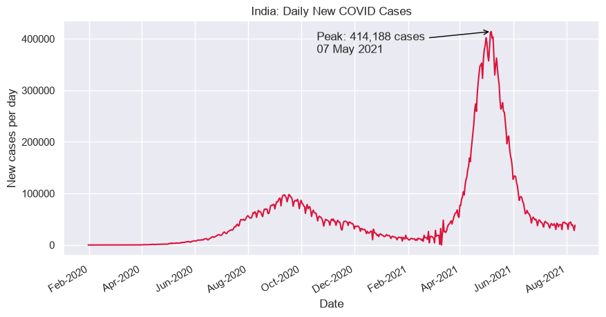
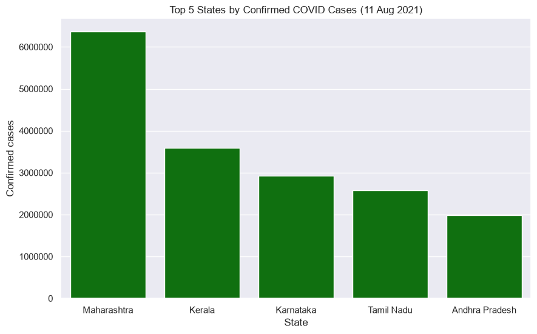
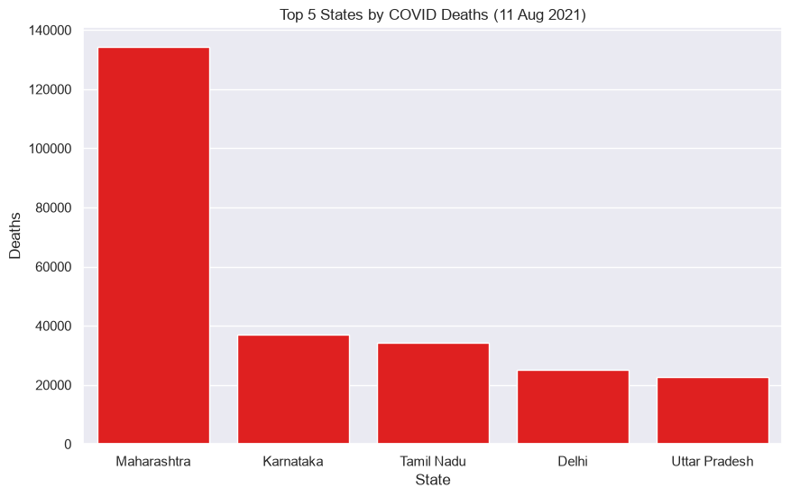
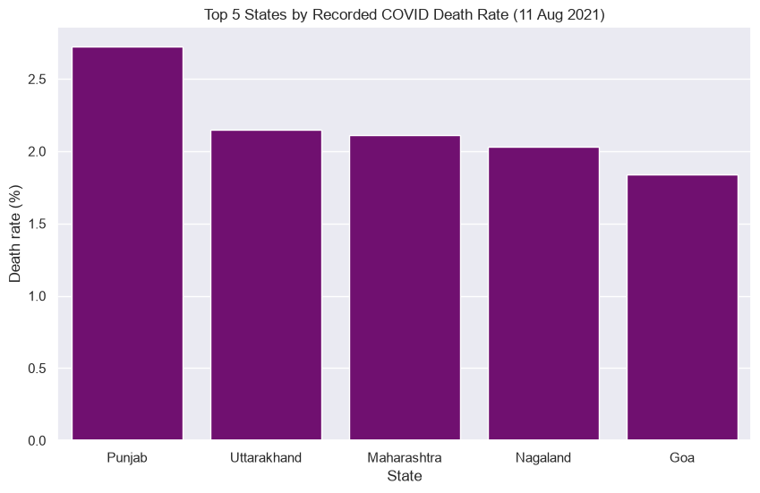

# COVID-19 in India: Exploratory Data Analysis

    

An exploratory analysis of state-wise COVID-19 cases and deaths in India from **30 Jan 2020 to 11 Aug 2021**, covering 36 states and union territories. The project cleans messy real-world data, answers four questions, and presents the results as charts.



## Contents

- [Dataset](#dataset)
- [Questions and Answers](#questions-and-answers)
- [Key Findings](#key-findings)
- [Data Cleaning](#data-cleaning)
- [Project Structure](#project-structure)
- [How to Run](#how-to-run)
- [Limitations](#limitations)
- [Next Steps](#next-steps)
- [Author](#author)

## Dataset

**Source:** [COVID-19 in India](https://www.kaggle.com/datasets/sudalairajkumar/covid19-in-india) by Sudalairaj Kumar on Kaggle. Please see the Kaggle page for the dataset's terms of use.

This project uses the `covid_19_india.csv` file: **18,110 rows** with one row per state per day. The Kaggle download also contains vaccination and testing files, which are not used here.

| Column | Meaning |
|---|---|
| `Date` | Reporting date |
| `State/UnionTerritory` | State or union territory |
| `Cured` | Cumulative recovered patients |
| `Deaths` | Cumulative deaths |
| `Confirmed` | Cumulative confirmed cases |

> **Key idea:** `Confirmed`, `Cured` and `Deaths` are **running totals**, not daily numbers. State comparisons therefore use only the latest date, and daily new cases are found with `diff()`. Adding up every row would count the same cases many times.

## Questions and Answers

| # | Question | Answer |
|---|---|---|
| 1 | Which states have the most confirmed cases? | **Maharashtra** (6.36M), then Kerala (3.59M) and Karnataka (2.92M) |
| 2 | Which states have the most deaths? | **Maharashtra** (134,201), then Karnataka (36,848) and Tamil Nadu (34,367) |
| 3 | Which states have the highest recorded death rate? | **Punjab** (2.72%), then Uttarakhand (2.15%) and Maharashtra (2.11%) |
| 4 | How did daily new cases change over time? | **Two waves.** The second peaked at 414,188 cases in one day on 7 May 2021 |

## Key Findings

1. **Maharashtra is the biggest outlier.** It has the most confirmed cases (about 20% of India's total) and the most deaths (about 31%).
2. **Cases and deaths don't rank the same.** Kerala is #2 in cases but is not in the top 5 for deaths, while Delhi and Uttar Pradesh are.
3. **Death rate tells a different story.** Maharashtra is #1 in deaths but only #3 in recorded death rate, and Punjab is first.
4. **India had two waves, and the second was much bigger.** Daily cases peaked at about 98,000 on 17 Sep 2020, then hit a record 414,188 on 7 May 2021.







## Data Cleaning

The raw data had no nulls and no duplicate rows, but it still had hidden problems:

| # | Problem | Fix |
|---|---|---|
| 1 | `Date` stored as text; `Sno` and `Time` not useful | Converted to datetime; dropped both columns |
| 2 | Typos and star marks in state names (`Karanataka`, `Telengana`, `Maharashtra***`) giving 46 names | Mapped to correct names, leaving 40 |
| 3 | `-` used as a hidden missing value in 97.5% of two columns | Dropped both columns |
| 4 | 63 rows that are not real states (`Unassigned`, `Cases being reassigned to states`) | Dropped (0.3% of the data) |
| 5 | One region listed under three names | Renamed one name; dropped one row that would duplicate a date |

**Result:** 18,046 rows, 5 columns, 36 states and union territories, with no nulls and no duplicates. Each fix was checked for side effects (for example, that renaming created no duplicate state-date rows).

## Project Structure

```
covid-india-eda/
├── data/
│   ├── covid_19_india.csv         # original dataset
│   └── covid_clean.csv            # saved by the cleaning notebook
├── notebook/
│   ├── 01_data_cleaning.ipynb       # load, inspect, fix problems, save clean data
│   └── 02_data_visualization.ipynb  # questions, findings, charts, takeaways
├── images/                        # charts saved by the notebook
├── requirements.txt
└── README.md
```

## How to Run

```bash
git clone https://github.com/ibrahimkhanmohammad/covid-india-eda.git
cd covid-india-eda

python -m venv .venv
.venv\Scripts\activate          # Windows
# source .venv/bin/activate     # Mac/Linux
pip install -r requirements.txt
```

Open the notebooks in VS Code or Jupyter, select the `.venv` kernel, and run them **in this order**:

1. `01_data_cleaning.ipynb` creates `data/covid_clean.csv`
2. `02_data_visualization.ipynb` creates the charts in `images/`

## Limitations

- Death rate is a **recorded** rate. It depends on how many cases were detected and reported, so it does not prove one state is more dangerous than another.
- The data ends on 11 Aug 2021.
- Findings show patterns in this dataset, not causes.
- Case counts are not adjusted for state population, so large states naturally rank higher.

## Next Steps

- Compare states per 100,000 people, using population data
- Add a 7-day rolling average to smooth the daily cases chart
- Break out daily cases for individual states to compare how their waves differed
- Combine with the vaccination data from the same Kaggle dataset

## Author

Ibrahim · [GitHub](https://github.com/ibrahimkhanmohammad) · [LinkedIn](https://www.linkedin.com/in/ibrahimkhanmohammad/)
